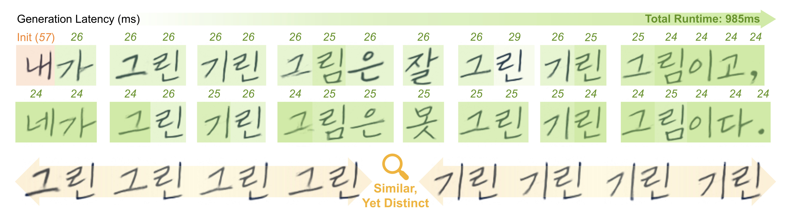
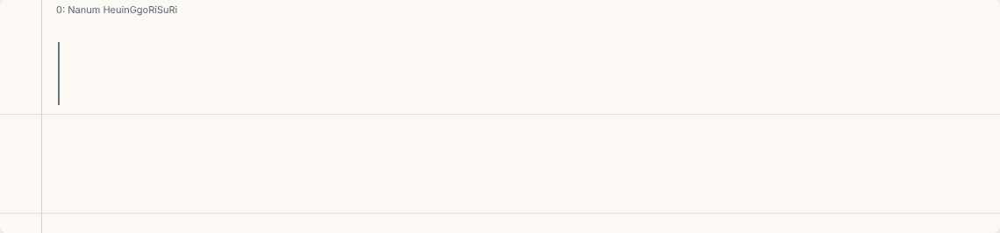
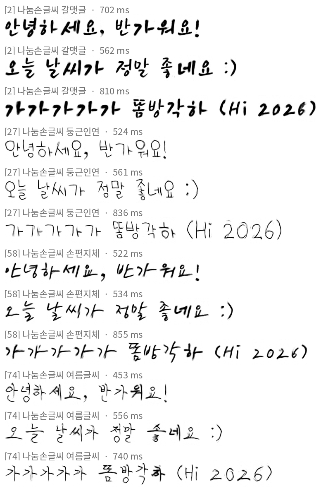

# CV-2-Diffusion-FlowFonts
FlowFont generates Korean handwriting glyph by glyph in real time. A rectified-flow U-Net conditioned on jamo and writer style is pretrained on open fonts, fine-tuned on Nanum Handwriting, then reflowed and distilled to one network evaluation. On held-out syllables it keeps 97.6% jamo accuracy with 128× fewer evaluations than 64-step diffusion.



📄 Paper: [FlowFonts.pdf](docs/FlowFonts.pdf) · Slides: [FlowFonts_Presentation.pptx](docs/FlowFonts_Presentation.pptx)

<p align="center"></p>

## Setup
```bash
cd handwriting
pip install -r requirements.txt
# optional, for CLIPScore: pin torch so open_clip does not replace it
pip install open_clip_torch transformers "torch==$(python -c 'import torch; print(torch.__version__.split("+")[0])')"
```
Unzip the dataset `font_ko_v2` next to `handwriting/` (or pass `--data <path>`). Add `--split dev` to any command for a quick check.

## Train
```bash
# 1. font pretraining (rectified flow), Nanum Handwriting excluded
python train.py --stage pre --objective rf --exclude_nanum --data ../font_ko_v2 --epochs 10 --amp
# 2. fine-tune on Nanum Handwriting -> 64-step teacher
python train.py --stage ft --init runs/pre_rf_seed0_nonanum.pt --data ../font_ko_v2 --epochs 30 --amp
# 3. reflow + one-step distillation -> 1-NFE student
python reflow.py --teacher runs/ft_rf_seed0.pt --data ../font_ko_v2 --w 1.5 --amp
```
Diffusion baseline: same `train.py` without `--objective rf`; progressive distillation: `distill.py`.
Multi-GPU: launch any of these with `torchrun --nproc_per_node=N`.

## Evaluate
```bash
python classifier.py --task jamo  --data ../font_ko_v2 --epochs 3
python classifier.py --task style --data ../font_ko_v2 --epochs 5
python eval.py --ckpt runs/reflow/ft_rf_seed0_reflow_distill.pt --data ../font_ko_v2 --steps 1
python eval.py --ckpt runs/reflow/ft_rf_seed0_reflow_distill.pt --speed_only --device cpu
python dashboard.py --runs runs
```
All methods A–F over seeds 0–2: `bash experiments.sh`. Data-budget ablation: `FRAC=0.1 bash extra_frac.sh pre|scratch`.

## Demo
```bash
python live_demo.py --ckpt runs/reflow/ft_rf_seed0_reflow_distill.pt   # http://127.0.0.1:7862
python demo.py      --ckpt runs/reflow/ft_rf_seed0_reflow_distill.pt   # Gradio
```



## Dataset
`dataset_tools/` rebuilds `font_ko_v2` (421 OFL font styles + 109 Nanum Handwriting fonts, 2,449 characters, 64×64). With a work folder `$W` (`pip install fonttools brotli pillow numpy`):
```bash
python3 -I make_jobs.py $W && cp jobs.json $W/          # bundled jobs.json reproduces the same font list
python3 -I harvest.py $W/harvest_work $W/jobs.json --budget 3000
python3 -I select_fonts.py $W/harvest_work
python3 -I render_faces.py $W/harvest_work --procs 2
python3 -I dehint.py pre $W/harvest_work                 # then re-run render_faces.py
python3 -I assemble.py $W/harvest_work $W/build/font_ko_pretrain $W
python3 -I render_v2.py pre $W/harvest_work $W/harvest_work/extras
# unzip Nanum Handwriting into $W/ft_src/ (use Python zipfile; unzip breaks Korean file names)
python3 -I render_v2.py ft $W/ft_src/clova-all $W/ft_faces && python3 -I dehint.py ft $W/ft_faces
python3 -I assemble_v2.py pre $W/harvest_work $W/build_v2/font_ko_pretrain $W
python3 -I assemble_v2.py ft  $W/ft_faces     $W/build_v2/font_ko_finetune_nanum $W
```

## Layout
| Path | Contents |
|---|---|
| `handwriting/` | model, training (`train.py`, `reflow.py`, `distill.py`), sampling, evaluation, demos |
| `dataset_tools/` | dataset construction and license checks |
| `docs/` | paper (`FlowFonts.pdf`) and presentation (`FlowFonts_Presentation.pptx`) |

All fonts are SIL OFL 1.1; per-font provenance ships with the dataset.
